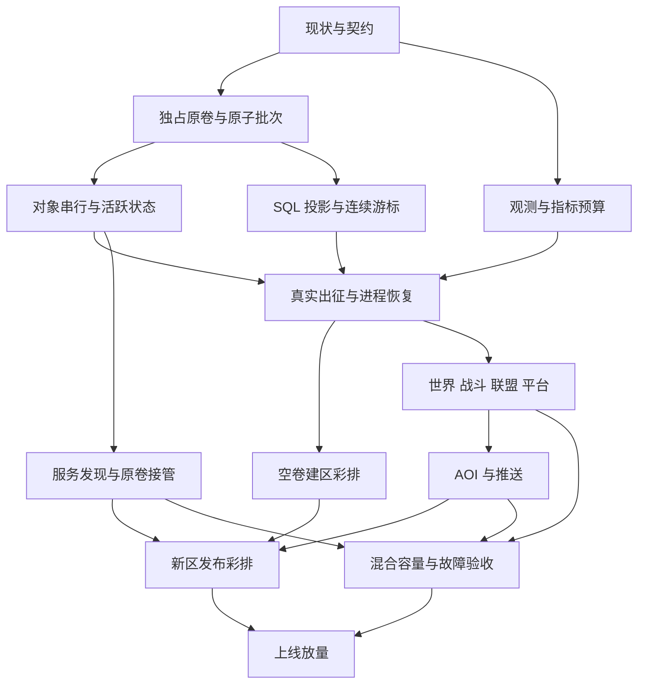

# SLG 生产架构任务清单

更新日期：2026-11-06。

本清单有 **50 项主线任务、4 项扩展任务**。优先交付一条能经受 GAME 进程崩溃的真实出征链路，再接入其余玩法并发布新区服。允许从空状态启服，不做旧代码、旧协议或旧数据的兼容层。MIG-01/02 保留任务编号，改为新卷建区与新区发布验收。

主线覆盖同区城建与经济、行军、采集、PVE、PVP、驻防、集结、联盟领地，以及通信、持久化、恢复和运维。跨服、合服、单区世界写入分片、完整探索玩法列入扩展任务；如果发行范围包含这些玩法，相应任务必须加入上线门槛。客户端、美术、完整策划数值与渠道交付需要配套计划，本清单不代表完整商业游戏已经具备发布条件。

## 架构基线

- 同一区服的 Player、City、Economy、Army、Hero、World、Alliance 和战斗结算由一个 GAME 写入原区服卷。内存处理活跃对象；关键变更、业务日志、回执、任务与事件在同一个 RocksDB WriteBatch 提交，发布内存版本后回成功。MySQL 游戏表由 GAME 后台按区服日志异步更新。账号、支付订单由各自服务直接写 MySQL，发货经 GAME 按订单去重。
- Army 唯一维护兵力、批次和占用关系；World 引用批次并维护行军、驻防和集结状态。Economy 唯一维护资产及预留。在线与离线玩家使用同一套持久化规则。
- Battle Worker 独立部署，只计算固定输入，没有玩家数据库写权限。AOI 独立维护可重建投影与推送，不参与战斗、资产或占用裁决。
- Gateway 到目标 GAME 复用异步 unary gRPC；推送使用独立 Channel 上的长流。连接、实例健康和区服所有权分别管理。
- etcd 发布目录和任期，Gateway 缓存路由。接管要求排除旧写者、取得原卷独占权并校验区服/卷身份、打开同一库完成恢复，随后才能发布 ACTIVE。原卷缺失、空卷或旧写者未排除时停服待处置。
- 玩家请求、攻击、到期任务、战斗结果、发货和修复都按实际变更对象参与有界串行调度。同对象一次执行一个冲突命令，无关对象并行；同区多对象一次预留写资格、一个原子批次提交。业务引用最新本地已提交版本，MySQL 滞后不影响立即撤回。
- 故障承诺限于 GAME 进程退出且原操作系统与卷仍可读取，已确认游戏操作 RPO=0。WAL 开启、manual_wal_flush=false、sync=false。机器断电、整盘丢失及异机自动接管属于不同承诺，另列恢复策略，不从过期 MySQL 投影自动重建游戏权威。
- 单区 10,000 在线、峰值 2,000 条业务命令/秒是初始容量目标。单区写入能力、热点对象能力和全平台多区容量分别验收。

Unity 原生游戏连接使用 TCP/TLS 和长度前缀 Protobuf 帧，账号及区服目录走 HTTPS。已实现 v2 鉴权、七个强类型玩法接口和心跳。会话代次、路由任期和推送恢复仍按 DES-04、NET-02/03 推进。卷独占是架构前提；云环境、容器编排与 MySQL 部署产品在 OPS-02/03 确定。

## 当前基础与任务状态

已有能力以 [实现状态](implementation-status.md)、[组件设计](component-design.md) 为准；详细目标以 [目标架构](server-architecture.md) 为背景。任务表用于把本次确定的生产边界落到执行顺序，不把设计目标标记为已实现。

| 当前基础 | 接下来的增量 |
| --- | --- |
| Gateway、UC、GAME 和 Battle Worker 独立运行，复用 gRPC 通道 | 多实例路由、独立推送流、服务发现 |
| UC 账号库独立；区服 RocksDB 为权威，GAME 后台有序写入 MySQL 游戏投影 | STORE-05 已接入磁盘水位、只读预演和[隔离卷首次清理验收](journal-retention.md)。后续补齐快照证明链、压缩空间观测与线上执行控制 |
| 活跃 Player 冷加载分池、同账号有界串行、空闲回收；同矿的到达、采满与召回按玩家和矿点联合调度 | 扩展到多玩家、多地块、持久依赖与其他 World 对象 |
| 采集和 NPC 从出征到返城，战斗输入固定、远程纯计算、GAME 幂等结算 | PVP 双方预留与取消裁决、驻防与集结 |
| 纯地图几何算法、进程恢复检查 | 按区服日志重建 AOI、地图推送、容量和发布演练 |

DES-01 已完成。STORE-01/02 已有原卷身份验证、原子提交、日志与回执。STORE-03 的单玩家驻留和到期唤醒已落地。SLICE-01 已覆盖真实网关出征、召回、离线采集、NPC 战斗与按原请求 ID 查询回执；已接通 STORE-04 的 MySQL 投影和停库追赶；其余验收还涉及地图事件和指定故障点。BATTLE-02 的独立 Worker 和有界派发已用于 NPC；PVP 的多对象准备、结算和显式取消依赖后续任务。容量以新区实测为准。[状态归属](game-write-inventory.md) · [强杀验证](../scripts/check-realm-march.py) · [负载验收](high-load-design.md)

### 源码入口

| 当前入口 | 对应任务 |
| --- | --- |
| [GameRpcService](../slg_game/src/main/java/com/slg/game/GameRpcService.java)、[ActivePlayers](../slg_game/src/main/java/com/slg/game/realm/ActivePlayers.java) | CORE-02、STORE-03。把单账号调度扩展到真实受影响的多个对象。 |
| [RealmJournal](../slg_game/src/main/java/com/slg/game/storage/RealmJournal.java)、[RealmProjection](../slg_game/src/main/java/com/slg/game/projection/RealmProjection.java) | STORE-04。按已提交的连续序号写入投影，并在同一 MySQL 事务推进消费位置。 |
| [行军阶段](../slg_game/src/main/java/com/slg/game/realm/MarchTasks.java)、[战斗结算](../slg_game/src/main/java/com/slg/game/realm/NpcBattles.java)、[Worker](../slg_battle/) | WORLD-02、BATTLE-01 至 04。从 NPC 单玩家规则扩展到 PVP 双方及援军。 |
| [RouteIndex](../slg_core/src/main/java/com/slg/core/world/RouteIndex.java)、[UpstreamClient](../slg_gate/src/main/java/com/slg/gate/UpstreamClient.java) | VIEW-01、NET-02/03。地图几何索引接入独立 AOI，Gateway 负责订阅连接与推送。 |

## 第一组 规则与契约

这组输出是后续实现的共同输入。需要策划决定的规则在 DES-02 列出选项、推荐值与影响，未确定的规则不能被实现细节悄悄代替。

| 编号与类型 | 任务及交付物 | 前置依赖 | 验收条件 |
| --- | --- | --- | --- |
| DES-01 设计（已完成） | [写入入口与归属清单](game-write-inventory.md)，含当前命令、后台写者、目标归属和发行范围 | 无 | 已核对 GAME 权威记录、UC 账户、定时/回调/投影与支付/GM 边界，明确从新区空状态起步及原卷故障承诺 |
| DES-02 设计 | 定义出征、撤回、驻防、战斗、取消、返城、集结状态机；确定护盾、迁城、退盟、增援、医院容量、掠夺与快照生效时点 | DES-01 | 每个转换具有前置状态和唯一决议；攻击到达与派兵、迁城、护盾、报名截止等竞争均有顺序示例；明确集结规模上限 |
| DES-03 部分完成（玩家与采集点） | 定义 realmId/volumeId、对象键、版本与出征等业务事实，划分 RocksDB 状态/日志/回执/任务和 MySQL 查询模型，定义首版编码、连续序号、快照和去重保留 | DES-02 | 已落地[角色身份、玩家与采集点契约](player-world-model.md)及对应专用查询表。跨玩家战损完整批次和多地块占用待验收 |
| DES-04 设计 | 定义 Unity TCP/TLS 帧、内部 gRPC、身份绑定、requestId、业务键、会话代次、路由任期、错误与推送游标 | DES-02、DES-03 | 区分未受理、确定拒绝、已提交、结果未知；列出正常、重复、断链与重连时序；未知协议版本有明确错误 |
| DES-05 设计 | 固定容量场景、日志积压/磁盘软硬水位、对象/内存/IO 预算、持续时长和进程恢复 RTO；区分进程退出、断电、永久丢卷 | DES-01 | 重启同 OS 原卷时已确认操作 RPO=0；明确 10,000 在线/2,000 命令每秒的成功率、P99、热点/分散负载、容量与停写阈值；执行验收前填定具体预算与 RTO |

## 第二组 本地提交、对象调度与投影

先建立 STORE-01/02 的卷与批次，再接 CORE-02 的统一调度。STORE-04 的投影可与对象生命周期并行。收据、到期任务、回放与订阅通过同一批次发布；下表的依赖决定执行顺序。

| 编号与类型 | 任务及交付物 | 前置依赖 | 验收条件 |
| --- | --- | --- | --- |
| CORE-01 增强 | 建立首版 RocksDB 键与编码版本、SQL 投影 schema/消费位置和初始化工具；分开运行与建表账号 | DES-03 | 在独立空目录/空库完成初始化，核对格式标识、日志起点及消费游标；不支持的格式须拒绝启动 |
| STORE-01 新增 | 为 GAME 引入 RocksDB 生命周期、独占数据卷与单写打开，持久化区服/卷身份和格式版本；配置 WAL 开启、manual_wal_flush=false、游戏批次 sync=false | CORE-01、DES-05 | 两个写者竞争最多一个成功；检测到缺卷、错卷、空卷、旧写者未排除时停写且不就绪；仅显式建新区才可初始化，进程退出原卷可重开 |
| STORE-02 新增 | 建立区服业务日志与原子提交入口；短提交阶段分配连续区服序号，将已决定的事实、涉及对象新版本、回执、待办/事件及日志末尾写入一个 WriteBatch，提交后才发布内存 | STORE-01、DES-04 | 在写前、写中、写后未回包等位置退出后，原卷仅有“全部存在”或“全部不存在”，区服序号连续；写入结果不确定时暂停相关对象并查权威回执；重复请求不能重复扣兵 |
| CORE-02 部分完成（玩家与单个矿点） | 将玩家邮箱调度从单个账号扩展到受影响 Player/Army/World/Alliance 等对象；多个对象统一顺序全取或等待，通过版本检查、短暂保留执行权处理一次决议 | STORE-02、DES-04 | 已覆盖同矿排队、超时、冷加载顺序与不同矿并行；完整验收还须把战斗、支付和修复等接入，多个对象的执行资格保持到提交与发布完成 |
| STORE-03 新增 | 实现 Player/World 热状态的按需装载、并发首次装载合并、规约化内存发布、空闲回收；已提交对象的读路径使用内存或本区 RocksDB | CORE-02 | 登录和离线事件并发只激活一个对象；登出且无在途/未决操作时可驱逐；离线被攻可重载；MySQL 停更时立即撤回仍见刚提交的行军；判定失败后不会泄露部分新状态 |
| STORE-04 已实现 | 在 GAME 内增加可停启的 MySQL 投影写入器，沿区服序号有界读取日志；变更业务表和“连续已应用位置”同一 SQL 事务提交 | STORE-02、CORE-01 | 在更新表与更新游标前后分别中断，重启无双加、无越过空洞；观测投影延迟、重试与失败停留位置；SQL 不可用期间提交在安全预算内继续，超限限制新写并保留已确认任务 |
| CORE-03 增强 | 建立 Economy 资产流水和 Army 唯一批次/预留模型，覆盖英雄占用、城内、出征、驻防、战斗、返程、伤兵与死亡 | STORE-03 | 重复派兵、并发扣款、英雄重复占用被正确处理；库存无负值、批次只有一个有效用途；资源与兵力可按来源去向核对 |
| CORE-04 部分完成 | 已实现持久回执、输入摘要、按原 ID 重试和[按角色查询原始结果](api.md)。普通回执目前全量保留。后续定义过期请求的拒绝协议及长期经济去重键 | CORE-02、DES-04 | 写成功回包丢失仍返回原结果；同 ID 不同参数拒绝；到期请求不会以新请求运行，重复发货/领取均只生效一次 |
| CORE-05 增强 | 将任务、领域事件、去重记录纳入游戏提交批次；以 taskId/generation/dueAt 调度，向外部消费者提供已提交事件流、连续位置与重建接口 | CORE-02、CORE-04 | 进程退出不丢任务和事件；重启补到期、重复投递、撤回后旧到达均不产生第二次效果；坏任务隔离且有审计；AOI/Battle 不打开游戏库或直接提交游戏状态 |
| STORE-05 部分完成（磁盘保护、预演、隔离卷首轮实清） | 按所有必需消费者的连续位置、安全保留窗口和已验证快照制定业务日志分段清理；给当前状态、任务、回执分别设置保留条件 | STORE-04、CORE-05 | 隔离验收覆盖落后游标、冲突归档、清后强杀、恢复回执及一次返城。后续验收连续多轮清理、在线并发写入仲裁、压缩回收延迟与磁盘水位 |
| STORE-06 新增 | 实现启动状态机：独占验证 → 恢复本地权威状态、待办和必要索引 → 发布 readiness；投影写入器从已提交 SQL 游标后台续跑 | STORE-03、STORE-04、CORE-05 | 在原卷重启完成后，新请求读到最新本地版本，补跑到期任务且只生效一次；MySQL 追平不作为 readiness 前提，只按既定水位决定能否接写；恢复时长计入 RTO |
| CORE-06 增强 | 已完成自增账号、建角区角色 ID 和当前区归属；待建立跨网关会话代次、重连、踢旧会话、撤销令牌及认证后角色路由 | CORE-04、DES-04 | 伪造角色/区服被拒绝；旧会话迟到命令不能修改状态；跨网关重连沿用角色与业务回执；离线角色仍可被世界事件处理 |

### 首条交付链路

在隔离区服用既有“出征 → 到达 → 返城”业务做最小闭环。这里可以先用已有本机网关和计算器，生产路由、PVP、集结随后接入。不要先让两套权威存储同时处理同一批线上玩家。

| 编号与类型 | 任务及交付物 | 前置依赖 | 验收条件 |
| --- | --- | --- | --- |
| SLICE-01 验收 | 从 Gateway 发起真实出征，迁移该命令、撤回、到达、返城、回执查询及基础地图事件到本地路径；记录端到端故障与资源守恒结果 | CORE-03、CORE-04、STORE-06、OPS-01 | 扣兵、占用英雄、创建行军/到达任务及回执同时存在；断开投影 MySQL 仍可立即撤回；在提交前和成功回包前后分别强杀 GAME，原 ID 重试得到唯一行军，停机期间到期只结算一次；不同玩家可并行 |

## 第三组 通信与连接

NET-01 的现有七个玩法操作全部使用独立 Protobuf 请求和响应。从每个操作的协议方法生成 Unity 调用、Gateway 白名单和 GAME 分发。建角、出征、召回保存可区分原操作的持久回执。新增玩法按同一机制登记，客户端与区服成套发布。[接口与断线恢复](api.md) · [Unity 调用示例](../clients/unity/README.md)

| 编号与类型 | 任务及交付物 | 前置依赖 | 验收条件 |
| --- | --- | --- | --- |
| NET-01 增强 | 维护独立玩法请求与响应、协议生成、版本检查和错误映射 | DES-04、CORE-04 | 金额、兵力与 ID 不损失精度；未知字段及不支持版本的行为明确；同版本重试保留同一业务幂等键 |
| NET-02 增强 | 按实例与进程代次管理复用 Channel/Stub，区分命令与推送，配置预热、上限、空闲回收、连接退避和调用 deadline | NET-01 | 连接随目标实例而非玩家数增长；实例替换后旧 Channel 退出；断链和 deadline 不触发无条件重放写命令；连接和在途调用均有界 |
| NET-03 新增 | 实现独立长流推送协议，包括订阅控制、ACK 层级、恢复游标、事件 ID、断流恢复及会话绑定 | NET-01、CORE-05、CORE-06 | 明确 Gateway 接收与客户端应用是不同确认；长流重建后可恢复或补快照；推送不挤占命令预算；跨网关会话迁移不误投他人事件 |
| NET-04 增强 | 完善网络、队列、线程、数据库和推送的条数/字节预算；实现公共接入保护、内部 mTLS 身份与调用权限 | NET-02、NET-03、DES-05 | 慢消费者与大消息不会造成无界积压；网络线程不执行阻塞数据库/战斗逻辑；过载拒绝与结果未知可区分；未授权服务、过期证书被拒绝 |

## 第四组 服务发现与区服接管

| 编号与类型 | 任务及交付物 | 前置依赖 | 验收条件 |
| --- | --- | --- | --- |
| ROUTE-01 新增 | 建立 etcd 实例目录、区服路由发布及 Gateway 本地缓存，包含实例代次、endpoint、epoch、就绪状态和 watch 恢复 | STORE-01、CORE-02、DES-04 | 目录只发布已经独占原卷并就绪的实例；旧任期不能覆盖新路由，过期路由请求被拒绝；watch 中断后重建；业务请求不逐条访问 etcd |
| ROUTE-02 新增 | 建立区服/原卷绑定、UC 动态区服目录与受控接管：排除旧写者、独占同一卷、按 STORE-06 恢复，再登记 ACTIVE | ROUTE-01、STORE-06、NET-02 | 第二候选、空卷、过期任期、旧进程暂停/复活分别演练，只有已确认唯一写者可接流；原卷不可用时暂停该区，不从 MySQL 旧投影启动替代实例 |
| ROUTE-03 新增 | 实现计划重启、Gateway/GAME 摘流排空、恢复游标和路由切换；形成停旧、交还原卷、启新及拒绝旧会话的发布步骤 | ROUTE-02、CORE-06、NET-03 | 排空期间新请求有明确去向，在途提交可核对；推送断流可重建；写者未隔离时起新实例失败且无数据变化 |

## 第五组 世界与行军

| 编号与类型 | 任务及交付物 | 前置依赖 | 验收条件 |
| --- | --- | --- | --- |
| WORLD-01 新增 | 从首条闭环扩展到按冲突对象裁决的世界调度，将玩家命令、到达、撤回、护盾及结果提交接入持久化状态转换 | SLICE-01、DES-02 | 同目标事件按已定义规则裁决；重启不丢已提交决议；不依赖线程碰巧的执行顺序；无关对象可并行，热点队列有上限 |
| WORLD-02 增强 | 统一出征、加速、撤回、驻防、返城生命周期，将 Army 批次、英雄占用、行军、任务、回执和事件原子关联 | WORLD-01、CORE-03、CORE-04 | 途中断线/重启不丢兵；旧定时器失效；返城与结算/撤回竞争只有合法转换生效；携带资产与返还部队只交付一次 |
| WORLD-03 新增 | 实现城市位置代次、占格约束、迁城、资源点与设施占用、护盾和目标资格校验 | WORLD-01、CORE-03 | 不能重复占格或占用同一排他目标；迁城与攻击到达按规则裁决；过期 AOI 位置不能绕过检查；范围占用按统一对象协议处理 |
| WORLD-04 增强 | 将采集、NPC 与世界资源生成接入正式任务和战斗链路；完成离线生产、训练、治疗等到期协同 | WORLD-02、WORLD-03、BATTLE-03 | 采集占用与收益不重复；离线玩家可完整完成流程；长期停机后任务按预算追赶，不能反复扫描全区或造成无界补发 |

WORLD-01/03 已在固定采集点完成首个实例。两支队伍可同时出征，到达时只有一支占矿，另一支空载返城。已验收占矿时强杀、双方归还兵力、矿点复用及 MySQL 对账；城市迁移和多格排他约束仍属后续任务。[游戏规则](realm-march.md) · [隔离验收](../scripts/check_realm_mine.py)

## 第六组 战斗与结算

| 编号与类型 | 任务及交付物 | 前置依赖 | 验收条件 |
| --- | --- | --- | --- |
| BATTLE-01 增强 | 实现 PVP 战斗准备的本地原子批次，固定双方/增援快照、battleId、输入摘要、规则及算法版本、随机种子和所需预留 | WORLD-02、WORLD-03、CORE-03 | 攻击到达与守军出征不能复用同一兵力；医院容量、资源预留、迁城等遵守 DES-02；准备后属性变更不篡改输入；保留业务预留，释放对象执行资格再计算 |
| BATTLE-02 增强 | 将计算从 GAME 线程池提取为独立 Battle Worker；提供有界分派、纯计算接口、确定性算法及旧任务版本支持 | BATTLE-01、NET-01 | Worker 无玩家库写权限；同输入同版本同结果；杀 Worker 后重算原任务；无法支持的版本明确拒绝，在途任务所需版本保留至完成 |
| BATTLE-03 新增 | 实现同区 PVP 原子结算与显式取消决议；结算伤亡、伤兵、战利品、目标状态、返程、战报与收据 | BATTLE-02、CORE-05 | 重复/迟到结果只生效一次；取消与结算互斥，取消提交后才释放预留；计算超时不自动退兵；旧 owner 不能结算，新 owner 可处理匹配原持久化输入的结果 |
| BATTLE-04 增强 | 完善战报重放、军队/资产核对、异常任务诊断及幂等修复命令；覆盖取消、结算与返城恢复 | BATTLE-03、CORE-04 | 能从记录核对初始兵力、幸存、伤兵、死亡和携带资源；坏任务隔离可定位；修复命令经过权限、区服写权、版本、幂等与审计，迟到结果不会推翻修复决议 |

NPC 当前保留待计算任务并退避重试。BATTLE-03 扩展到 PVP 时，释放预留必须对应显式、持久化且与结算互斥的取消决议。

## 第七组 联盟与集结

| 编号与类型 | 任务及交付物 | 前置依赖 | 验收条件 |
| --- | --- | --- | --- |
| ALLIANCE-01 增强 | 完善联盟成员唯一关系、人数上限、职位权限、科技、贡献与帮助去重；角色联盟信息只作展示投影 | CORE-02、CORE-03、DES-02 | 同时加入不同联盟、满员竞争、职位变化与操作竞争均正确；科技消耗与生效原子；成员投影延迟不影响权限裁决 |
| ALLIANCE-02 新增 | 实现集结报名、成员到位、名单锁定、出发、取消、交战与分别返还；每份贡献引用成员自己的 Army 批次 | ALLIANCE-01、WORLD-02、BATTLE-03 | 截止同时报名、未到位成员、队长取消、退盟、断线与重复返还均有确定结果；集结汇总不生成新兵力库存；规模遵守事务预算 |
| ALLIANCE-03 新增 | 实现旗帜、领地、设施争夺和增援权限；联盟资格/消耗与 World 占用通过同区事务协调 | ALLIANCE-02、WORLD-03 | 同格竞争不会双重占用；权限变化、拆建、攻击和占领不会重复扣资源或留下无归属部队；热点设施按既定裁决规则执行 |

## 第八组 地图投影与广播

| 编号与类型 | 任务及交付物 | 前置依赖 | 验收条件 |
| --- | --- | --- | --- |
| VIEW-01 增强 | 提取独立 AOI 进程，通过 GAME 提供的已提交事件流维护空间索引、对象版本、删除标记和快照重建进度 | CORE-05、WORLD-02、WORLD-03 | 重复/乱序事件不回退位置或复活删除对象；长路线穿过视野、跨 Chunk 更新正确；AOI 无需访问本地 RocksDB 目录；超出重放窗口可用一致快照恢复 |
| VIEW-02 新增 | 建立快照与增量的一致切换点，完成视野订阅、切换、权限过滤、版本缺口补拉和跨网关恢复 | VIEW-01、CORE-06、NET-03 | 快照生成与订阅建立之间发生变化不会漏推；任期切换后的旧流消息被拒绝或重新同步；断链后可续传或重建；不可见对象不泄漏；订阅范围与频率受限 |
| VIEW-03 增强 | 实现按订阅扇出的共享编码、合并与降频；可靠通知和可合并地图消息分别预算，并与命令链路隔离 | VIEW-02、NET-04 | 不同视野、热点围观、慢客户端均受控；地图积压不拖死资产命令；地图可以重建，可靠结果仍可查询/重放；记录扇出放大率和字节积压 |

## 第九组 平台与运营业务

| 编号与类型 | 任务及交付物 | 前置依赖 | 验收条件 |
| --- | --- | --- | --- |
| PLATFORM-01 增强 | 接入独立 MySQL 支付订单与可重试的 GAME 发货指令；GAME 对订单号去重，“已发货”与资产变化同批写本地，补投、奖励领取和双方回执可查 | CORE-03、CORE-04、CORE-05、CORE-06 | 在订单已提交/指令未送达、GAME 已提交/通知丢失分别重试，均只到账一次；订单与到账可对账；全局订单服务不直接修改角色资产 |
| PLATFORM-02 增强 | 建立邮件、任务、活动配置发布、权威积分和赛季结算；通知与待领取附件分离，榜单作为读侧投影 | PLATFORM-01、CORE-05、BATTLE-04 | 已到账通知不能再次领取；活动按版本与服务端时间运行；发奖基于固定结算数据；旧任务使用原配置，回滚配置不会撤销已提交资产 |
| PLATFORM-03 新增 | 独立聊天服务与频道权限，完善屏蔽、限流和会话重连；明确聊天历史与通知的保存范围 | CORE-06、NET-03、ALLIANCE-01 | 聊天故障不阻塞 GAME；退盟后不能继续接收未授权频道；跨网关重连、慢消费者和发送洪峰可控 |

## 新区初始化与发布

生产首区只切入独立 GAME 卷和独立游戏投影库；旧开发库保持隔离，无须迁移玩家、回执、事件游标或原客户端。新区首笔业务提交后，这个卷就是该区唯一的恢复源。

| 编号与类型 | 任务及交付物 | 前置依赖 | 验收条件 |
| --- | --- | --- | --- |
| MIG-01 新增 | 从空状态演练新区建区：分配 realmId 与 volumeId，显式初始化专用空目录和独立投影 schema，登记卷身份、初始日志及投影位置 | SLICE-01、STORE-04、CORE-01 | 开服前核对区服身份和初始状态；重复初始化、非空目录、错误区服或卷均被拒绝，旧 SQL 数据无读写，重启只能打开原卷 |
| MIG-02 验收 | 演练新区发布、摘流与回退手册；验证网关路由、限流、后台任务与投影前后一致，明确首笔已提交业务的恢复分界 | MIG-01、STORE-05、ROUTE-03、WORLD-04、BATTLE-04、ALLIANCE-03、PLATFORM-02、VIEW-03 | 首笔业务前可停止发布；一旦提交业务（含后台任务或发货），必须保留原卷和回执，使用能读取该格式的版本或前向修复。验证排空、强杀和同卷恢复，不从空卷或 SQL 投影替代已受理区服 |

## 第十组 生产运行与验收

监控埋点和故障用例随功能开发推进；本组的综合验收不替代各任务自己的验证。具体资源、持续时长和阈值以 DES-05 固定的口径执行，不能看到结果后再降低标准。OPS-04 随功能就绪逐步输出剖析报告，未达标的阶段报告可以触发优化；不必等整项容量验收完成才开始改进。

| 编号与类型 | 任务及交付物 | 前置依赖 | 验收条件 |
| --- | --- | --- | --- |
| OPS-01 新增 | 建立分段观测：入站/对象排队、本地写/内存发布、GC、原生内存与 compaction、磁盘余额、日志积压/消费者位置、到期延迟及恢复耗时 | DES-04、DES-05 | 能按 requestId/marchId/battleId/区服日志序号定位故障；SQL 写入慢和本地写入慢能分开判断，磁盘/积压分级告警，避免逐玩家标签 |
| OPS-02 新增 | 提供预发布与生产部署清单、原卷绑定及排他策略、资源预算、网络隔离、证书轮换和健康检查 | NET-04、ROUTE-02、DES-05 | 明确堆/堆外、Rocks block cache/memtable、线程栈、容器限制、SQL 连接及磁盘余量；自动扩副本不能绕过原卷独占和恢复门槛 |
| OPS-03 验收 | 建立 RocksDB 一致备份与可核对的区服序号，MySQL 独立备份/恢复、投影重建与支付流水对账；记录永久丢卷后的人工恢复边界 | STORE-05、STORE-06、DES-05 | 从隔离副本成功恢复并核对日志终点、资产和待办；证明确认后进程退出的 RPO=0，另记录备份覆盖点及卷丢失情况下可能缺失的范围；不从滞后投影自动接管 |
| OPS-04 验收 | 建立可复现混合负载；分别压分散玩家真实出征/返程和集中攻击同一城，同时量化地图扇出、到期洪峰、MySQL 追赶、CPU 和磁盘 | VIEW-03、BATTLE-04、ALLIANCE-03、WORLD-04、PLATFORM-01、PLATFORM-02、PLATFORM-03、OPS-01、OPS-02、OPS-03 | 按 DES-05 验证单区 10,000 在线、2,000 条业务命令/秒；区分受理、提交成功、业务/过载拒绝、未知结果；报告各类 P99、稳定吞吐和积压排空时间；压测期间保持动态路线，可复验 |
| OPS-05 验收 | 在写入前/期间、提交后回包前后强杀 GAME，原卷重启；并测试在途战损/集结、MySQL 失联、目录异常、旧写者存活、缺卷/磁盘水位、Worker 重算及断链 | ROUTE-03、VIEW-03、BATTLE-04、ALLIANCE-03、PLATFORM-01、OPS-01、OPS-02、OPS-03 | 已回成功的操作完整恢复，跨玩家和行军没有半边结果；重复请求/任务仅生效一次；原卷不可得时停写；SQL 积压有界，恢复时长与积压符合 DES-05；保留故障点及前后对账证据 |
| OPS-06 验收 | 完成兼容升级、排空、按区灰度、前向修复/受控回退、值班告警、修复权限与数据归档，交付上线检查手册 | OPS-04、OPS-05、MIG-02 | 预发布切换、恢复与容量验收均有记录；协议/编码/玩法规则兼容，在途任务所需旧版本保留；本区按 MIG-02 的首笔新写边界放行，发行范围任务附证据 |

## 第十一组 扩展任务

这四项单独跟踪，未完成时不能把系统描述为已经支持跨服、合服、单区写入分片或完整探索。若 DES-01 将其中任何一项纳入发行范围，它就成为 OPS-06 的额外前置，并补入容量与故障场景。

| 编号与类型 | 任务及交付物 | 前置依赖 | 验收条件 |
| --- | --- | --- | --- |
| EXT-01 新增 | 独立跨服战场及资产交接协议：冻结、接收、激活、结算、返还，携带 transferId、任期和状态查询 | CORE-03、CORE-04、CORE-05、ROUTE-02、BATTLE-03 | 家园与战场不同时使用同一资产；交接超时不自动解冻；两端重启、响应丢失和重复返还后数量守恒 |
| EXT-02 新增 | 区服迁移与合服：身份、联盟、地块冲突、在途任务、历史回执和路由统一迁移 | EXT-01、CORE-01 | 隔离演练可恢复，角色身份和历史幂等键连续；在途部队不丢失；明确停止接入窗口及回退边界 |
| EXT-03 新增 | 由容量阶段报告确认单区权威写入超预算后，设计并实现世界写入分片及跨分片所有权交接；AOI Chunk 不直接作为写入归属 | EXT-01、DES-05 | 触发依据为 OPS-04 的阶段性剖析产物，不要求其验收通过；以证据说明收益；跨边界行军、战斗和资产交接可恢复；双写及热点转移验证通过后才启用 |
| EXT-04 增强 | 将英雄/护卫探索演示接入关卡进度、体力、阵容、奖励和正式规则版本 | CORE-03、CORE-04、PLATFORM-01、BATTLE-02 | 重复通关回包不重复发奖；探索与远征的英雄占用规则明确；关卡进度、消耗和奖励原子提交，可重启恢复 |

## 依赖顺序与并行方式

按下列顺序认领。编号所属组是责任划分，实际开始条件见每项的“前置依赖”。OPS-01 在首条行军之前完成；MIG-01 在隔离新区提前彩排，实际放量排在版本验收之后。

| 顺序 | 可认领任务 | 本阶段交付 |
| --- | --- | --- |
| 1 | DES-01；其后 DES-02 与 DES-05 并行，再做 DES-03、DES-04 | 现有写入口清单、故障承诺、资源预算、数据/接口契约；开始 OPS-01 埋点设计 |
| 2 | CORE-01 → STORE-01 → STORE-02；并行完成 OPS-01 | 隔离区服的原卷拒错、原子批次、一条已提交记录与故障注入结果 |
| 3 | CORE-02 → STORE-03 → CORE-03；另一支 CORE-04 → CORE-05；STORE-04 可从 STORE-02 后并行 | 统一对象入口、活跃数据/兵力、后台任务/回执、MySQL 连续投影 |
| 4 | STORE-06 → SLICE-01；并行 STORE-05、CORE-06 | 首次公开演示：玩家真实出征，强杀 GAME、原 ID 重试、离线到达，SQL 落后时能撤回 |
| 5 | MIG-01；按依赖推进 NET/ROUTE、WORLD/BATTLE、ALLIANCE/VIEW/PLATFORM | 新区建区彩排；将所需玩法接入本地协议，扩展 PVP、联盟与地图推送 |
| 6 | OPS-02/03 → OPS-04/05；功能齐备后 MIG-02，最终 OPS-06 | 容量、恢复和新区发布证据；只对取得原卷写权且就绪的新实例放量 |

图示用于展示工作流；任务表中的编号依赖是执行依据。一个任务只有在前置产物满足其接口或验收要求后才能完成；依赖中的设计项允许先做接口草案，不能提前宣称集成通过。

DES-01 的[写入盘点](game-write-inventory.md)已可供实现核对。DES-02、DES-05 细化玩法和量化预算；首条存储链路是 STORE-01/02，首条通过网关可演示的玩家链路是 SLICE-01。

## 阶段验收

| 阶段 | 完成条件 | 明确证明什么 |
| --- | --- | --- |
| M0 契约确定 | DES-01 至 DES-05 完成 | 身份、所有权、规则时点、状态机、错误和指标已有一致定义 |
| M1 首条恢复闭环 | CORE-01 至 CORE-06、STORE-01 至 STORE-06、SLICE-01 完成 | 原卷单写、同区原子性、幂等与待办、投影游标和日志清理经真实行军验证 |
| M2 通信与接管 | NET-01 至 NET-04、ROUTE-01 至 ROUTE-03 完成 | 多 Gateway、推送与原卷接管可工作，错卷或无法排除旧写者时停写 |
| M3 同区玩法闭环 | WORLD、BATTLE、ALLIANCE 各组完成 | 出征、交战、结算、返城及多人集结的资产和状态可核对 |
| M4 完整接入与运营 | VIEW、PLATFORM 各组完成 | 玩家能通过正式协议观察世界、恢复事件、聊天、领取奖励和完成发货闭环 |
| M5 生产验收 | MIG-01/02 与 OPS-01 至 OPS-06 完成，发行范围内 EXT 项完成 | 空卷建区、发布、摘流及原卷恢复已演练；在约定负载与故障模型下，性能、恢复及运营流程都有可复现证据 |

阶段不是全部串行的日历排期。M2 可以与 M3 并行推进，M4 的各模块可在各自契约稳定后启动；M5 的观测和演练准备应尽早进行。

## 每项任务的完成标准

1. 交付物可定位：设计、代码、schema、协议、配置或操作手册有明确路径，状态变更附对应记录。
2. 关键语义可解释：受理与提交时点、参与对象、权限、顺序、幂等、超时、取消和恢复入口写清楚。
3. 验证与风险匹配：事务和状态机验证实际不变量、竞争及故障；文档任务检查内容、链接与依赖，不为文档改动运行整套业务测试。
4. 资源有界：网络、队列、线程、数据库连接、内存、事件积压和数据保留都有预算或策略。
5. 上线可维护：日志与指标可定位失败，协议/schema/规则升级方式明确；不能用“编译通过”或“能演示”代替任务验收。

容量报告应同时给出成功率、业务拒绝、过载拒绝、未知结果及恢复情况。未知结果本身不等于资产损坏，但必须能用原业务 ID 收敛。达到连接数、通过空 RPC 吞吐测试或完成一次正常重启，都不能单独代表生产验收完成。
