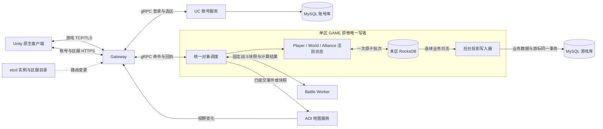
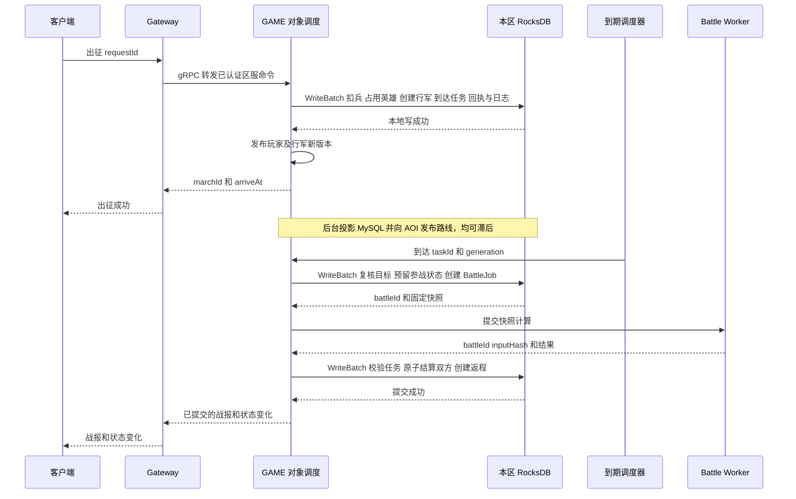

# 类无尽冬日 SLG 服务端架构设计

**目标架构（2026-11-05）**：一个区服由一个可写 GAME 管理。Player 与 World 的活跃状态在内存中运行，每次关键操作原子写入本区 RocksDB，随后发布内存状态并回复玩家；同区 MySQL 游戏表由后台异步更新。UC 账号与全局支付订单仍以各自的 MySQL 库为权威。区服在线读、扣兵、到达、战斗结算及重试均读取 GAME 已提交状态。

《无尽冬日》公开玩法包含资源争夺、联盟、科技、英雄和玩家竞争，可作为业务范围参考。[官方玩法介绍](https://www.centurygames.com/games/a/)。下文是针对当前项目提出的设计，不代表该游戏的实际内部架构。

当前可运行的链路是 Gateway → GAME → 原卷，以及 GAME → Battle Worker → 玩家邮箱结算。建角、派兵、召回、采集、NPC 战损和返城均使用本地提交。到达、召回和采集中涉及同一矿点时，按玩家和矿点共同调度。UC 使用独立的 MySQL 账号库。GAME 已按连续序号异步投影到独立 MySQL 游戏库。多玩家原子结算、AOI、所有权目录和自动接管分项验收。[已实现的行军](realm-march.md) · [实现状态](implementation-status.md) · [容量验收](high-load-design.md) · [任务清单](production-task-plan.md)

## 1 设计范围与关键决策

| 决策 | 首版方案 | 原因与演进条件 |
| --- | --- | --- |
| 业务组织 | 区服内模块化 GAME，领域模块保持独立 | 同一 Realm 的 Player、World、Alliance 共用一次本地原子提交；跨区需单独的资产交接协议 |
| 区服隔离 | `realmId` 是路由、数据和故障隔离边界 | 多区服增加容量；单区热点仍需单独解决 |
| 并发模型 | 按实际修改的对象协调，冲突操作串行，独立对象共享工作线程并行 | 受理键涵盖被攻击玩家、行军、地块、联盟等；本区短提交阶段分配日志顺序 |
| 状态权威 | GAME 决策；本区 RocksDB 持有可恢复的最新状态和业务日志 | 新命令读取已提交内存状态或本地最新记录；MySQL 是可滞后的业务投影 |
| 故障目标 | GAME 进程崩溃，原 OS 和原数据卷完整；已确认操作零丢失 | 使用同一卷、单一写者和 RocksDB WAL；掉电、永久丢盘及无原卷异机接管不在此承诺内 |
| 世界模拟 | 事件驱动，记录起止时间和到达事件 | 客户端插值移动，无需服务端逐帧同步全地图 |
| 战斗 | 持久化快照 → 无状态计算 → 权威结算 | 计算可重试，伤亡和奖励只能生效一次 |
| 消息投递 | GAME 按本地已提交的业务日志发布事件，后台按消费位置重试 | MySQL 异步投影、AOI 广播和战斗计算均不占用客户端出征的等待时间 |
| 扩展路径 | 先拆广播和计算，再拆世界权威状态 | 优先拆掉低耦合的负载，保留清晰的一致性边界 |

首版包含城建、熔炉与生存参数、资源生产、研究、训练、英雄编队、联盟、采集、PVE、基础 PVP、邮件与活动框架。跨服争霸、合服、复杂实时野战放在后续阶段。

默认战斗是到达后计算结果的 SLG 战斗。若产品需要逐秒改变阵型、途中拦截或实时操控部队，需要另设战场 Tick 与同步协议，不能直接沿用纯到达结算模型。

## 2 部署与请求路径

当前工程运行 Gateway、UC、GAME、Battle Worker 四个独立应用。AOI 是待实现的独立服务。支付平台通过可重投的发货指令连接 GAME，图中省略该链路，见 §9.2。

- **UC / 平台**负责身份、区服列表和账号到角色的归属；支付订单与 GAME 发货分开保存。
- **Gateway** 持有客户端连接、身份绑定、限流和临时订阅；按目标实例复用 gRPC Channel 与异步 unary 调用，独立长流传递推送。etcd 发布实例和区服路由，网关本地缓存并跟踪变更。业务流量直接去 GAME。
- **GAME** 同一区同一时刻只允许一个写者独占原卷和 RocksDB 句柄，独立对象并行执行。它通过已提交事件向消费者供数；MySQL 写入器在 GAME 内后台读取本地日志，独立的 Worker、AOI、运营服务不打开该 RocksDB 目录。
- **Battle Worker / AOI** 分别计算固定输入的战斗结果和可重建的空间视图。资源、预留、目标占用和阵亡均由 GAME 判定。AOI 的视野变化经网关推送。

路由使用认证后的 `accountId → playerId → currentRealmId → ownerNode/epoch`。`playerId` 中的建角区号只参与标识；路由须读取当前区，不能解析 ID 前缀推断所在区。角色归属必须由服务端确认，不能信任客户端随请求传入的玩家或区服编号。重连到任意网关后，都重新解析当前区服路由。

## 3 领域模块与数据所有权

| 模块 | 权威数据与能力 | 边界 |
| --- | --- | --- |
| Player | 角色资料、解锁进度、玩家版本 | 全局账号不属于 Player |
| Economy | 资源、货币、背包、预留、增减流水 | 所有资产增减必须通过该模块的事务接口 |
| City | 熔炉、建筑、工人分配、生产、研究、训练任务 | 城市地图坐标归 World；生产结算后通过 Economy 入账 |
| Army 与 Hero | 兵种数量、伤兵、英雄成长、编队、部队批次 | 每批兵力只能处于一个归属状态 |
| World | 城市位置、资源点、设施、占用、行军、驻防、集结 | 世界事件按规则顺序处理，不信任客户端坐标 |
| Alliance | 联盟资料、成员、权限、科技、贡献、帮助 | 领地空间占用归 World，联盟资格归 Alliance |
| Battle | 输入快照、战斗任务、结果、战报 | 计算器无经济写权限；结算由 Realm 事务协调器调用各领域接口 |
| Activity 与 Quest | 活动实例、任务进度、积分、奖励资格 | 发奖通过奖励收据与 Economy，不直接改余额 |
| Mail 与 Reward | 邮件、附件资格、领取记录 | 邮件展示与奖励到账分开；领取必须原子记账 |
| Social 与 Ranking | 聊天、屏蔽、榜单投影 | 排名可延迟；活动发奖基于冻结的权威积分结果 |
| Platform 与 Billing | 账号、区服目录、渠道订单、发货指令 | 订单属于全局；物品归区服角色，跨库按投递与回执协调 |

领域模块只暴露命令、查询与变更接口。应用层汇总本次业务决定，涉及多个模块时在同一个本区 RocksDB 实例提交一个原子批次。模块按职责保存可独立加载的余额、任务、兵力、行军、奖励记录与版本，避免一处改动重写整个 Player。领域计算期间不访问远程服务。

玩家首次登录、离线受到攻击或定时任务触发时，调度器按同一玩家 ID 合并并发加载，从本地最新状态激活唯一的 Player。在线期间复用已提交内存状态；登出后可留宽限期，待已受理命令、在途提交和结果不明的写入全部结束后再淘汰。卸载只释放缓存，成功操作在回包时已保存。活跃行军、占用、集结和战斗预留有独立生命周期，主人离线后继续存在。世界索引按需常驻或从本地记录重建。

## 4 命令执行与一致性协议

### 4.1 顺序与事务各自负责什么

客户端命令、攻击结算、时间任务、支付发货、GM 和 Worker 回调共用一个入口。根据实际读取并需要保持稳定、或要修改的对象确定执行键（例如玩家、行军、地块、联盟）。同玩家冲突操作串行，不绑定专属线程；独立对象使用共享有界工作池并行。同一目标有多个约束时，一次取得全部所需对象的短期执行资格；条件未满足先排队，不允许持有 A 等待 B。提交前重验对象版本和世界位置代次；执行中发现需新增对象时释放资格、补齐后重新校验。

一次修改按以下顺序执行：

1. 认证、会话及区服代次检查、限流，确定执行键；在途命令占用全局和每对象预算。只在受理之前明确拒绝过载请求。
2. 在对象执行资格内查本地请求回执，重复请求按摘要返回原结果。读取已提交内存版本；首次加载或修复时从本地最新记录读取。游戏在线读不回查滞后的 MySQL。
3. 据规则校验并生成私有变更集，记录确定结果、对象新版本、资产流水、到期任务和要发布的事件。其他命令看不到这份草案。
4. 区服短提交阶段按实际落入批次的顺序分配连续 `journalSeq`。序号水位、业务日志、受影响对象的最新状态、索引/任务以及请求回执在同一次 RocksDB `WriteBatch` 生效。使用业务日志重放确定的结果，避免以新配置重新执行旧指令。批次失败或结果不明时不跳过序号。只有日志追加阶段排序，全区业务计算可以并行。
5. 本地写成功后，在仍持有相关对象执行资格时一次发布涉及对象的内存新版本，再给客户端回成功。写库工作交给有界执行器；A 等本地写时，其他无冲突玩家能继续工作。战斗计算、MySQL、地图广播均在此批次之外。本文后续“同区事务”均指这一协议。

已知写入失败时丢弃草案。结果未知或内存发布失败时，暂停冲突键并核对本地回执和最新版本后恢复；日志水位也不明时停止该区新日志追加，必要时重开原卷核对最后一次批次，不能复用或跳过不确定序号。无冲突的草案仍可在预算内准备，但不能先回成功。已写成功的决定以本地记录为准。网关超时不推断回滚，以原 ID 查回执或重试。内存只允许通过此入口修改；推送附实体版本，重连可拉取快照。

**写入选项及故障范围。** 业务批次启用 WAL（`disableWAL=false`），`manual_wal_flush=false`、`sync=false`。RocksDB 成功返回时写入已交给操作系统，满足本设计承诺的单独 GAME 进程崩溃恢复；操作系统掉电、磁盘毁损或换盘不在零丢失承诺内。部署必须显式验证这些选项、持久卷与文件系统权限。RocksDB 内部 WAL 由引擎维护，应用跨消费者同步读取的是独立的业务日志记录。[RocksDB 写入语义](https://github.com/meta/rocksdb/wiki/Basic-Operations#synchronous-writes)

### 4.2 幂等与必须保持的不变量

请求信封包含 `protocolVersion、requestId、sessionEpoch、commandType、payload`。服务端补充可信的玩家、区服和追踪信息。幂等键为 `(realmId, playerId, requestId)`，同时保存命令类型、请求摘要和结果；同一 ID 携带不同内容直接拒绝。

幂等覆盖网络重试、支付订单、邮件领取、任务、活动发奖和战斗结果。区分受理前拒绝、确定拒绝、已经提交和结果未知；只有显式持久受理的长流程可回 `PENDING`，重试继续同一流程。普通回执按可执行的协议重试窗口保留，过期 ID 须能识别并拒绝（例如会话/请求窗口水位）；无法识别时继续保留去重依据。支付订单、领取与经济业务采用长期唯一键。

- **余额不透支**：每次扣减检查可用余额；预留部分不能重复消费。转移类操作的转出与转入守恒，生产、消耗另记来源或去向。
- **兵力不复制**：兵力批次在城内可用、出征、驻防、战斗预留、伤兵、死亡等状态之间转移；可用数量不得小于零。
- **任务不重复完成**：`(taskId, generation)` 唯一决定一次完成；完成标记和收益在同一事务。
- **战斗不重复落账**：一个 `battleId` 只能有一次有效结算，重试只读取同一结果。
- **奖励不重复领取**：以 `(sourceType, sourceId, playerId, rewardSlot)` 约束业务奖励，领取记录与资产到账同事务。
- **空间不重复占用**：一个地图格或占用范围只能有一个有效对象；首版城市按单格或固定占用格集合建唯一约束。
- **区服不双写**：旧节点即使仍存活，也无法在新所有权代次下提交修改。

邮件须明确是“已到账通知”还是“待领取附件”。同一奖励不能先自动到账，再作为可领取附件重复发放。

### 4.3 MySQL 投影、事件与清理

本地业务日志记录 `realmId、journalSeq、业务ID、变更、版本、schemaVersion`；每条决定覆盖它涉及的全部对象。GAME 内后台写入器读取 MySQL 的连续游标，再从本区日志读取下一批，将涉及的业务表、归档流水与 `lastAppliedSeq` 放在**同一 MySQL 事务**中更新。重复投影先核对游标与业务唯一键；前一序号缺失或事件不能转换时停在缺口并告警。MySQL 提交响应不明时重读游标，不跨洞推进。积压按条数、最老年龄和本地剩余容量监控；超出硬预算前限流/拒绝新写入，为恢复保留空间。

同批保存需投递的事件。消费者按 `(consumerName, eventId)` 去重，持久消费者把业务效果和位置一并提交；可重建 AOI 使用有版本的完整快照及其连续水位，断流后补增量，超出保留窗口则重新取快照。投影的查询时效与资产归属分开；后台统计可显示截止序号，游戏写后读走 GAME 本地已提交状态。

业务日志与对象状态分开回收。设已清前缀截止于 F、原卷到 H、最近保留 K 条、已实际恢复验证的快照到 S。若每个必需消费者都已核实到 c，而且重连需读取 Jc，候选闭区间是 **[F+1, min(H−1, H−K, S, 各消费者的 c−1)]**。上界不超过 F 时无候选。任何身份、归档、连续性或恢复证明有疑问，就停止清理。当前仅在新建的隔离测试卷执行首轮实际删除。[清理边界与故障验收](journal-retention.md)

对象保留最新已提交版本。任务和回执的回收分别取决于结算生命周期、重试与业务去重窗口。活跃行军、待办、回执和 RocksDB 内部 WAL 均在业务日志删除范围之外。检查点和备份须登记区服、卷身份、事件水位、版本与校验，先验证可恢复，再回收其覆盖的历史。

## 5 三条核心业务链路

### 5.1 建筑升级与加速

`UpgradeBuilding` 在一个事务内校验前置建筑和队列，扣除资源，创建升级任务与到期任务，记录结果。`finishAt` 和 `configVersion` 在接受命令时确定。

加速命令锁定同一任务，先按服务端时间判断是否已经到期，再决定完成还是扣除加速道具。修改截止时间时增加 `generation`，旧定时通知到达后因版本不符无效。取消升级如支持，退款比例固定在任务规则中，并通过唯一的取消结算记录处理。

建造完成时，在一个事务内更新建筑等级、标记任务完成、应用一次效果并写通知。客户端倒计时归零只是展示，领取与后续解锁仍以服务端结果为准。

### 5.2 出征与战斗

行军主状态为 `OUTBOUND → ARRIVED → RESOLVING / GATHERING → RETURNING → COMPLETED`。撤回只能在允许状态进入 `RETURNING`；准备战斗后不能再通过撤回绕过结算。采集完成、返程到达也使用持久化到期任务。

出征事务把所选兵力从可用池转入该 `marchId` 的受控批次，并锁定本次编队需要的英雄，避免重复派遣。行军保存源位置、目标对象 ID、目标位置代次、出发时间、到达时间、路径与规则版本。首版建议固定路线和服务器计算的速度，行军加速更新版本与截止时间。

处理到达事件时重新验证目标是否存在、位置代次、护盾、敌我关系和可占用状态。首版规则建议：城市迁走后，不自动追踪新位置，原攻击返程；护盾在“战斗准备事务”提交前生效可阻止新战斗，之后不撤销已建立的战斗；已建立战斗守卫的目标在结算或取消前不能迁城。规则必须写进策划配置和测试。

同一目标的争夺按服务端受理顺序串行裁决。准备战斗时锁定相关聚合，以本次事务的 `snapshotAt` 结算相关已到期训练、研究与生产，按有效期计算 Buff，再写入目标战斗守卫，预留参战部队、伤兵接收额度和可能被掠夺的资产预算，并保存双方快照。该快照反映实际准备时刻的已提交状态，不回溯模拟 `arriveAt` 时的玩家数据。其他命令不能消费这些预留；快照固定后新增的兵和收入不自动进入本次战斗。

计算器只读取不可变输入：双方兵种、数量、英雄、技能、科技、Buff、随机种子、数值配置版本和战斗算法版本。随机数算法、遍历顺序、取整规则均固定，使用整数或定点数。相同输入必须给出相同结果，禁止计算器读取实时玩家属性。

结果作为内部命令按受影响的对象进入统一调度；在一个同区事务内验证 `battleId + inputHash + state`，应用双方伤亡、伤兵、资源转移、设施归属与返程任务，释放剩余预留，标记战斗已结算，写战报摘要和业务事件。掠夺到账先进入行军携带资产，成功返程后才入玩家钱包；死亡或其他掉落按独立规则结算。

计算超时只重试同一持久化任务，不直接退兵或返还资源。需要终止时，必须通过唯一的战斗取消状态转换释放预留，并保证迟到结果不能再提交。计算期间只保留业务预留，不长期占着对象执行资格。

### 5.3 联盟与集结

加入联盟时，成员唯一记录、联盟人数与容量、加入资格在同一个事务内校验更新，防止两个联盟同时接受一个玩家。角色档案里的联盟名称只是展示副本。

集结由 World 管理 `OPEN → LOCKED → MARCHING → RESOLVING → RETURNING → CLOSED`。报名、退出和截止事件按同一集结键排队，并协调有关玩家/军队，锁定名单后不能再插入成员。每个参战者独立记录已预留的部队，集结保存成员快照，避免人数和总兵力漂移。

联盟科技由 Alliance 管理，领地由 World 管理。建造旗帜的应用事务同时校验权限、消耗和占格。战斗中的联盟 Buff 在规则指定的锁定时刻写入快照；退盟不会隐式修改已开始的战斗。帮助加速按 `(helperId, taskId)` 去重，并复用建筑任务的版本协议。

## 6 地图 广播与时间系统

### 6.1 逻辑地图与 AOI

地图划分为固定大小的 Chunk，例如 `32 × 32` 格；该尺寸是调参起点。Chunk 用于视野订阅与索引，同一区服的世界状态仍由单一 GAME 管理，不同目标可在多个线程并行裁决。

客户端提交视野中心和缩放级别，服务端校验范围、频率和权限，只推送视野覆盖的 Chunk 及少量边界区域。采用“初始快照 + 版本增量”，每个对象与 Chunk 都有版本；缺口、重连或订阅切换时重新拉取快照。

城市和设施在状态变化时推送。行军只在创建、加速、撤回、到达等关键节点同步路径与时间，客户端计算中间位置。AOI 将整条线段索引到经过的分块，按观察窗口做精确相交与去重；即使起止点和部队当前位置都不在视野中，中途经过窗口的路线仍可见。

热点王城战将战斗裁决与地图展示分开：目标争夺保序，旁观者推送合并、降频并限制订阅规模。一次变化先生成共享增量，再按订阅者发送，避免重复序列化。不能为了降低广播压力而丢掉战斗结算、资产通知或任务完成记录。

### 6.2 离线生产与生存参数

离线产出保存 `lastSettledAt、rate、capacity、ruleVersion`。在速率固定的一段时间内计算：`产出 = min(剩余容量, 速率 × 有效经过时间)`，结算与余额变化在同一个事务。

熔炉燃料、温度、人口效率、食物、疾病或 Buff 会改变速率，因此要按事件边界分段。升级、燃料耗尽、仓库满、活动倍率变化前先结算旧区间，再启用新参数。不能把玩家上线时的速率乘整个离线时长。

首版建议用聚合人口与岗位模型；居民走动由客户端表现。若玩法确实要求每名居民独立健康和排班，再建立个体状态与分段模拟预算。

### 6.3 持久化调度与事件顺序

本地状态保存 `taskId、ownerId、type、dueAt、generation、status、payloadRef` 及按 `(realmId, status, dueAt, taskId)` 排序的到期索引，随创建/撤销/完成任务原子更新。内存时间轮或小顶堆只负责快速唤醒，宕机后从本区 RocksDB 分批重建。离线对象按需激活，不依赖在线人数或连接状态推动任务。

调度器投递任务时允许重复；真正处理时再次验证截止时间、版本与状态。通用后台任务可用有租期的领取机制，处理失败后重新领取；不能在执行业务之前永久标记完成。

世界事件采用实际执行时刻裁决，并明确区分到期时间、受理顺序与战斗依赖：

1. 普通出征直接走 §4.1 的一次本地提交。在明确要排队等待已有战斗等持久业务依赖时才写入持久化 Inbox，保存接收时间、目标和受理次序；返回 `ACCEPTED` 只代表已持久受理，最终 `COMMITTED` 才代表执行成功。
2. 调度器扫描已到期任务，按 `(dueAt, taskId)` 分批接入目标执行队列；以 `(taskId, generation)` 去重。不把任务倒插进已执行的历史命令。受理次序用于业务等待，与实际生效决定的 `journalSeq` 分开。
3. 有冲突的世界命令按受理顺序执行短事务；被已有战斗占用的目标，其后续冲突命令按产品规则拒绝或持久等待。其他独立目标可以继续执行。
4. 战斗结果属于已有步骤的继续执行消息，即 continuation。它携带原 `battleId` 恢复当前战斗，允许越过等待该战斗释放目标的普通命令；不能被这些等待者堵在队尾。结算或取消提交后，按原受理顺序恢复目标上的下一条命令。
5. 在原卷上重启的 GAME 重建 Inbox、目标等待队列和未完成战斗依赖；已固定的快照与已受理顺序保持不变，尚未准备的战斗读取恢复后实际准备时的权威状态。

`dueAt` 决定任务何时具备执行资格，也用于离线收益区间和调度优先级；它不是历史玩家快照时间。积压可能推迟真正的战斗准备，在此之前提交的护盾或成长可能改变结果。这是首版采用的明确规则，必须通过到期延迟告警、限流和过载降级控制。若产品要求严格按原定到达时刻裁决，则需将所有影响战斗的经济、成长与联盟变化纳入统一逻辑时间屏障，作为另一阶段的架构变更。

过载时对尚未受理的新命令返回可重试错误；已持久化受理的命令和到期任务必须继续处理或形成明确的终态，不能静默丢失。

时间戳统一 UTC；玩家显示时区与区服活动日历分开。业务截止时间采用受监控的服务端时钟，接收时间以区服持久化时间水位钳制，禁止倒退；节点时钟偏差超阈值时停止接受新的时间敏感命令。客户端时间不参与收益或战斗判定。

## 7 核心数据模型

当前首版的玩家身份、采集点占用、查询主键和索引以[玩家与世界对象契约](player-world-model.md)为准。后面各项同时列出后续城建、经济与跨玩家结算所需的逻辑记录。

以下是逻辑记录与必要约束，实施时设计 RocksDB 键空间/序列化版本及 MySQL 投影 DDL。可相互原子修改的区服对象必须处于同一个 RocksDB 实例；在统一调度和同批更新的唯一键/索引上落实约束。UC 与支付记录有各自的 SQL 事务边界。

| 数据 | 关键字段 | 约束或索引 |
| --- | --- | --- |
| `player` | playerId, accountId, foundingRealmId, currentRealmId, version | 角色 ID 永久不变，按当前区校验归属 |
| `asset_balance` | playerId, assetType, available, reserved, version | 玩家资产类型唯一；余额非负 |
| `asset_ledger` | transactionId, entryNo, playerId, delta, reason, sourceId | 流水分录唯一，转移可对账 |
| `building` / `city_task` | buildingId, level / taskId, type, dueAt, generation, state | 在城建对象执行资格内校验并原子占用队列槽位 |
| `troop_lot` | lotId, playerId, troopType, count, locationType, locationId | 批次位置唯一；转移与拆分有来源记录 |
| `hero_assignment` | playerId, heroId, assignmentType, assignmentId | 同英雄的活动占用唯一 |
| `world_occupancy` | cellId, objectId, positionEpoch, version | 区服内 cellId 唯一 |
| `march` | marchId, playerId, targetId, targetEpoch, arriveAt, state, version | 状态和到达时间索引；关联部队批次 |
| `alliance` / `alliance_member` | allianceId, capacity, memberCount / playerId, role | 一个玩家最多一个有效联盟 |
| `rally` / `rally_member` | rallyId, deadline, state / playerId, marchId | 集结成员唯一，锁定名单有版本 |
| `battle_job` | battleId, targetId, inputHash, seed, configVersion, engineVersion, state | 输入与最终结果不可被重复覆盖 |
| `combat_reservation` | battleId, resourceType, ownerId, amount, state | 同预留唯一；关联参战兵、资产与容量 |
| `mail` / `reward_receipt` | mailId / sourceType, sourceId, playerId, rewardSlot | 每份业务奖励只领取一次 |
| `command_receipt` | playerId, requestId, payloadHash, result, state | 请求唯一；含结果与实体版本 |
| `world_inbox` / `timer_task` | eventId, dispatchSequence, receivedAt / taskId, dueAt, generation, state | 可恢复受理顺序与到期扫描索引 |
| `world_waiting_command` | targetId, commandId, dispatchSequence, waitingBattleId | 持久化目标依赖，继续执行消息不被等待者阻塞 |
| `outbox` / `consumer_inbox` | eventId, aggregateId, version / consumerName, eventId | 发件可重试，收件去重 |
| `realm_meta` / `journal` | realmId, volumeId, epoch, schemaVersion, highSeq / journalSeq, commandId, changes | 身份与数据卷匹配；业务序号和本地批次同生效 |
| `projection_checkpoint` | realmId, streamId, lastAppliedSeq | 在 MySQL 与业务表同事务推进，按连续前缀确认 |
| `billing_order` | provider, providerTransactionId, targetRole, state | 全局渠道交易唯一，单独保存发货回执 |

省略表中的公共 `realmId` 不表示可以跨区误用主键。关键和索引必须体现区服作用域；账号及支付订单则使用全局作用域。ID 使用可验证不会重复的分配方案，跨服迁移保留全局稳定的业务 ID。

资源、兵力、付费货币采用明确范围的整数，乘法与累计先检查溢出。区服的资源判定和写后读始终落在 GAME 的已提交版本上。MySQL 游戏库和只读副本可供运营、分析与对账使用，报表标明数据水位。

## 8 Java 工程与技术选型

保持 Java 21、Maven 和现有 `slg_gate / slg_rpc / slg_uc / slg_game / slg_battle / slg_core` 边界。统一对象调度、内存生命周期、领域命令、本地提交和 MySQL 写入器在 GAME 内分层；内核只放小型公共类型与纯计算。Battle Worker 和 AOI 使用独立协议消费已提交快照/事件，部署后不能获得区服 RocksDB 的句柄。协议 DTO 在入口转换为领域命令，领域规则不依赖 Protobuf、Netty、RocksDB JNI 或 SQL。

| 位置 | 建议选择 | 使用边界 |
| --- | --- | --- |
| 运行环境 | Java 21、Maven | 沿用现有工程；实施时锁定依赖版本 |
| 接入层 | Netty TCP/TLS 与长度前缀 Protobuf 帧，账号 HTTPS，内部 gRPC | 按目标 GAME 复用连接、设 deadline、限流；推送流独立于业务请求 |
| 游戏存储 | 本地持久卷、RocksDB JNI、版本化编码 | GAME 独占实例；原子提交确定的状态、业务日志、回执与任务 |
| 关系存储 | MySQL InnoDB、HikariCP；JDBC/显式 SQL | UC 与支付各自负责本库；区服后台投影有独立线程与连接预算 |
| 服务发现 | etcd、网关本地缓存 | 发现实例和路由；区服写权依赖原卷排他与 GAME 生命周期 |
| 定时与消息 | 本地任务和业务日志、内存近期待办 | 时间轮失效从本地重建；消费位置与去重规则按用途记录 |
| 战斗并行 | 独立无状态 Worker，受限 CPU 并发 | 固定输入/配置/算法；GAME 接收结果并结算 |
| 可观测性 | OpenTelemetry、Prometheus、Grafana | 贯穿命令、事务、任务和结算的关联 ID |

Netty 提供异步事件驱动的网络处理能力，适合把连接层与业务执行器分开。[Netty 官方指南](https://netty.io/wiki/user-guide-for-4.x.html)。Java 21 虚拟线程可作为阻塞 I/O 的实现选项，但不会使 CPU 密集的战斗计算更快；仍须限制数据库连接数与任务积压。[Java 21 虚拟线程文档](https://docs.oracle.com/en/java/javase/21/core/virtual-threads.html)。

协议按版本协商，删除的 Protobuf 字段编号保留，避免旧客户端把新字段错误解析为旧含义。[Protobuf 协议指南](https://protobuf.dev/programming-guides/proto3/)。业务错误码区分可重试、状态冲突、资格不足与参数错误，防止客户端无止境重试。

## 9 恢复 发布与运营

### 9.1 所有权与宕机接管

目标只允许在**同一原数据卷上**恢复单一 GAME。先确认旧进程已退出/被隔离，获取卷的排他访问权和 RocksDB 打开锁，核对 `realmId / volumeId / schemaVersion`，才建立新代次。写者必须同时取得原卷排他权并通过卷内身份校验。拿不到原卷、原进程归属不明、发现身份错误或校验失败时，保持区服停止受理。

重启按顺序执行：独占原卷 → 打开并由 RocksDB 恢复 WAL → 验证本地状态与业务日志水位 → 恢复目标等待、预留、到期任务、战斗任务，重建 World 索引 → 就绪后向目录发布新代次路由。MySQL 暂不可达但本地日志保留安全、积压与磁盘预算充足时，GAME 可以先就绪；后台独立重连并核对连续游标再追赶，无法确认清理界限时暂停日志 GC。预算不足时按 §4.3 限流。Player 按需加载，无需在启动时读取全部历史角色，或混用落后的 SQL 快照与独立的本地版本。

| 故障点 | 恢复方式 |
| --- | --- |
| 本地写批次前退出 | 没有该业务决定；按原请求 ID 重试，不扣兵 |
| 写批次期间结果未知 | 重开原卷，由整批可见性和回执判断；没有原结果才重新校验，已存在则直接返回 |
| 本地提交、尚未发布内存或回包即退出 | 从最新记录重载，原请求只返回已保存行军 ID |
| 任务唤醒或事件通知丢失 | 扫描本地任务或从已确认日志位置续读 |
| 结果计算完但未结算 | 重新投递结果或按同一快照重算 |
| 已结算但战报推送失败 | 根据 battleId 查询，事件流重发或快照恢复 |
| MySQL 投影中断，或投影提交但响应丢失 | GAME 本地状态照常恢复；核对 MySQL 游标，补缺口，接近本地容量阈值先限流 |
| 原盘丢失、无法排除另一写者、或本地存储拒写 | 摘除区服写路由；停止受理/成功确认，人工核对故障范围 |

进程退出的验收目标为 **RPO = 0（仅对已确认的 GAME 操作）**。掉电、磁盘毁损或异机无原卷时，另按独立备份的最近水位制定恢复方案，禁止自动把异步游戏库提升成新的游戏写者。UC、支付库和 MySQL 投影仍分别需要备份、恢复与对账演练。

**新区发布**。首个生产版本从独立的空 GAME 卷和独立 MySQL 游戏投影开始，无须兼容原型存储、接口、历史回执或事件游标。显式初始化时登记区服、卷身份与格式版本；普通启动只打开已经登记的原卷。核对初始状态、日志与投影起点后发布路由。首笔业务前可以终止新区发布；一旦有游戏事实提交，包括定时任务和发货，就必须保留这份卷，摘流、排空并在原卷恢复或前向修复。旧开发数据库继续与新区隔离。[写入入口与归属清单](game-write-inventory.md)

### 9.2 支付 活动与配置

支付入口验证渠道通知后，用渠道交易唯一键保存订单和发货 Outbox；区服以订单 ID 幂等入账并生成发货回执，平台据回执更新完成状态。跨库状态暂时不同步时保持可重试，不因回执超时重复发货。退款和撤销通过独立业务状态与账目处理。

活动实例保存 `activityInstanceId、realmId、startAt、endAt、settlementState、configVersion`。截止后冻结资格和计分水位，排空截止前应计入的事件，再按固定结果生成逐人奖励收据；不能直接用仍在变化的展示榜单发奖。

策划配置编译为带校验和与版本的只读资源，先校验引用、数值范围和兼容性，再按区服灰度。建造、研究、活动和战斗保存所用规则版本，旧任务保留所需旧配置；线上热更新不改变已锁定战斗的结果。

发布时先停止接收新命令，排空在途本地批次和后台写入器，保留未完成任务及所有必要日志，退出旧进程后方可打开原卷。同一卷仅由支持其格式的版本恢复。当前强类型协议部署到新卷，采用 v2 的 Unity、Gateway、UC 和 GAME 成套上线。新区放行首笔写入后，以该区的新卷继续恢复或前向修复。

### 9.3 可观测性与管理能力

关键指标包括连接数与重连成功率、对象队列等待、最老到期任务逾期、本地批次延迟与错误、日志高水位、MySQL 连续游标与最老积压时间、AOI 重放水位、剩余磁盘、压缩造成的写停顿、战斗积压、未释放预留、重复请求命中率、资产与兵力对账差异。分别预算 JVM 堆、RocksDB 原生缓存与写缓冲、JVM 堆外/线程栈和 OS 页缓存。

日志关联 `requestId、realmId、playerId、marchId、battleId、eventId`。GM 操作具备权限控制、原因、操作者和前后状态审计，走相同领域命令；运营后台不通过任意 SQL 修改经济状态。账号凭据、访问令牌和支付密钥不进入普通日志。

## 10 容量假设与演进门槛

下面是首轮压测输入，不能用来承诺一台机器的容量或推断原游戏规模。

| 项目 | 假设或目标 | 如何验证 |
| --- | --- | --- |
| 单区连接 | 10,000 同时在线 | 长连接、心跳、地图订阅、批量重连和网络抖动 |
| 玩家主动命令 | 峰值 2,000 条每秒 | 按真实命令比例测试，另计任务与内部事件 |
| 世界敏感命令 | 规划场景可假设占 15%，即 300 条每秒；当前仅实现 PVE | 同目标排序、多目标可并行的事务协调与热点积压 |
| 突发流量 | 平均流量的 3 倍 | 活动开启、联盟集结、整点完成任务 |
| 地图下行示例 | 每人每秒 5 个增量，每个 200 字节 | 10,000 × 5 × 200 = 10 MB/s 载荷，另加协议与加密开销 |
| 普通命令延迟 | 服务端收到到提交 P95 小于 150 ms | 不含公网延迟与完整战斗计算；过载拒绝单独统计 |
| 到期处理延迟 | 正常负载 P99 小于 1 s | 收益按规定时间区间结算；战斗实际开始延迟必须可监测 |
| 区服进程重启 | 原 OS、原卷可用时，以 60 s 内恢复为初始 RTO 目标 | 用真实地图、积压任务和待结算战斗做强制终止演练；单独记录就绪及积压排空时长 |

单世界队列若平均每次串行步骤占用 5 ms，理论上限只有约 200 步每秒，且接近饱和时排队显著恶化。因此未来 300 条世界命令/秒不能全部依赖这一顺序通道，需要按可独立目标协调并行或进行有明确语义的合批；冲突目标仍须保序。当前已实现的玩家命令、AOI 与纯战斗计算不持有全区 Java 锁，实际容量见 [测量记录](high-load-design.md)。

固定测试机、输入分布和运行时预算。分散玩家实际出征与集中攻击同一城分别压测，以 10,000 在线、2,000 条主动业务命令/秒为目标，另计任务和内部事件。记录成功/拒绝/未知数、请求 P99、热键排队、本地写延迟、投影积压/磁盘空间、恢复耗时与地图扇出。历史测量不含真实行军且未通过峰值验收，不能作为新方案通过证据；维持现有峰值门槛（零过载拒绝、零未知、稳态成功吞吐至少为目标的 99%、成功请求 P99 ≤ 500 ms），场景细分与延迟口径在正式测量前固定。常态留出重启追赶和后台压缩的资源余量。

扩展按下面顺序进行：

1. **增加区服**：网关横向扩展，多个 Realm 隔离运行，数据库按区服分组；解决全服总量增长。
2. **拆计算与读取**：Battle Worker、AOI 广播、聊天、榜单可单独扩容；Realm 保留状态修改权。
3. **拆世界区域**：只有 World 排序队列持续成为瓶颈时，才引入区域所有权、区域租约和地图边界协议。Chunk 切分不自动带来写入并行。
4. **跨服战场**：单独的 BattleRealm 托管参战资格、位置和临时兵力，原区服冻结转出部分；结果携带 transferId 唯一结算。

区域迁移和跨服转移采用持久化 `PREPARED → ACTIVE → RETURNING → SETTLED` 协议：源端先冻结并签发唯一转移记录，目标幂等接受，任一时刻只有一端有使用权。超时先查询权威转移状态，不自动解冻原兵力。进入战斗的城市、部队和目标不得迁移；迟到消息通过所有权代次拒绝。首次上线跨服之前，需要单独完成这份协议的故障与补偿设计。

## 11 实施顺序与验收

任务、依赖、建区门槛与逐项验收统一维护在[生产任务清单](production-task-plan.md)。先完成范围与写入入口盘点，再建立原卷单写、本地提交、按对象调度与离线加载；用真实出征贯穿成功回包、投影、清理和进程恢复，再接入其余玩法、计算、广播、目录与平台。上线前验证新区建区、容量以及原卷恢复。

首批测试应覆盖真实故障窗口，而不是只验证接口返回成功：

- 同一请求同时抵达、响应丢失后重发、同一请求 ID 换参数。
- 同一份资源并发建造、消费和被掠夺，验证余额及流水守恒。
- 出征提交后进程退出，验证没有无主预留、丢失行军或重复兵力。
- 任务到期与加速同时发生，或旧 generation 的任务在重启后迟到。
- 战斗计算重复、迟到、计算版本不一致，以及结算前后进程退出。
- 护盾、迁城、驻防与多个攻击并发，验证按受理顺序和准备时刻裁决；重启保留已固定的战斗快照。
- 后续攻击已在等待目标时，迟到战斗结果仍能恢复原战斗并释放目标，不能形成队列死锁。
- 写者未退出或原卷不明时，新实例无法就绪；目录租约过期也不能从旧 MySQL 投影另起区服。
- 活动结束时积分消息积压、支付重复通知、邮件领取与发货重试。
- MySQL 停写/恢复、在提交数据与推进消费位置之间杀进程、消费者乱序、磁盘逼近上限和日志清理期间退出，验证不越过缺口，不清除行军、任务或仍可重试的回执。
- 世界大规模订阅、慢客户端、热点城堡排队、集中到期、配置灰度和后台压缩同时施压，分别核对热点与分散玩家延迟。

第一条可运行纵向链路为**登录 → 带原请求 ID 出征 → 收到成功后强制终止 GAME → 在原卷重启 → 再次提交同一请求 → 找回同一支部队 → 到达/返城只执行一次**。同时暂停 MySQL 投影，使成功回包、重新登录和后台追赶分别可验证；对照确认前后兵力、英雄占用、行军、任务、回执、世界视野与最终 MySQL 投影。目前已验证真实网关下的同卷强杀、待办恢复、原请求重试和返城。已用独立数据库验证停机期间的游戏写入、原卷重启、恢复追赶及重复投影。地图消费和生产容量仍需验收。[投影运行说明](mysql-projection.md)
